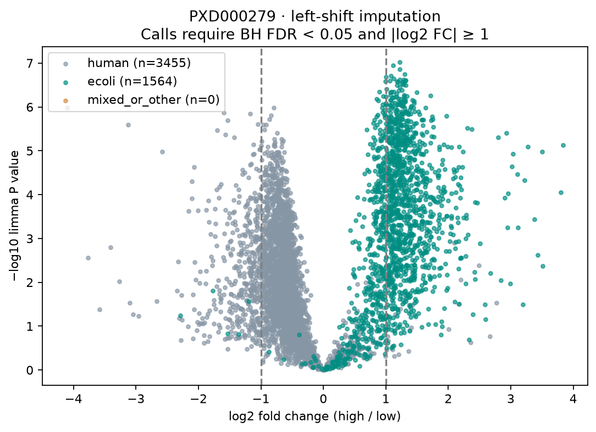
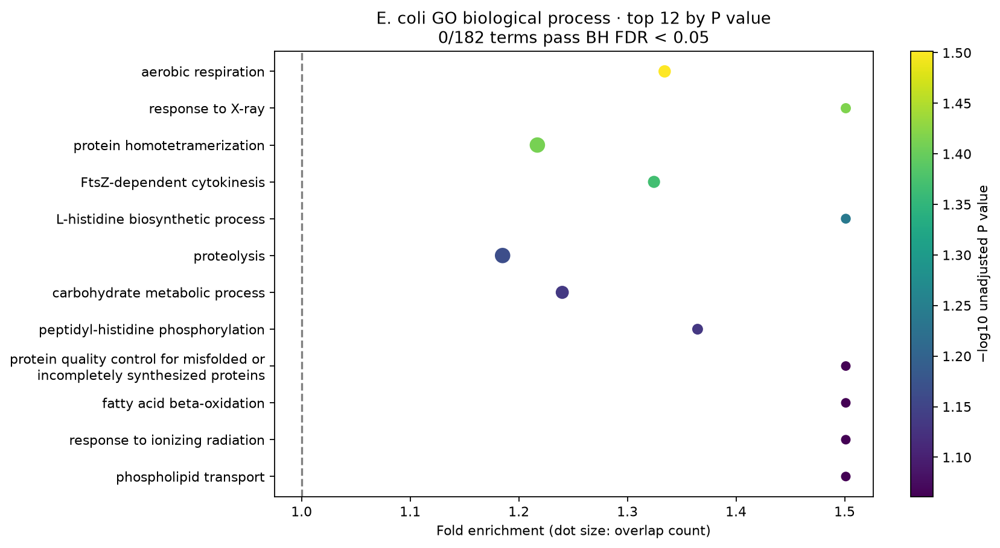
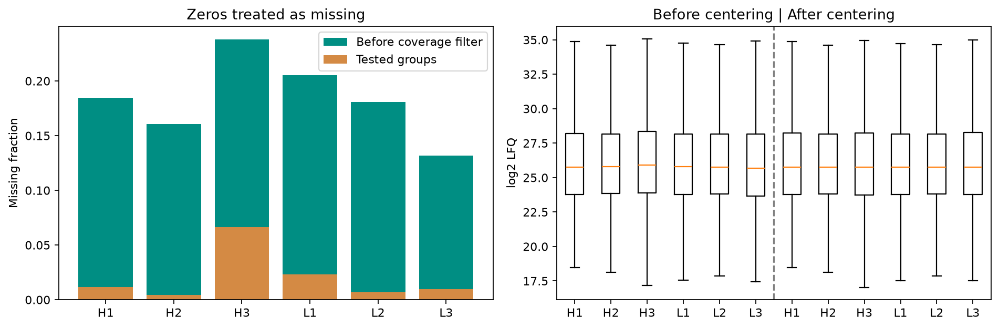
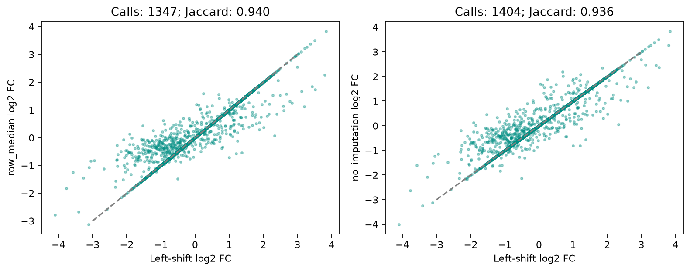

# Differential protein abundance in a public PRIDE benchmark

## Question

Can a reproducible differential abundance workflow recover the direction of an E. coli spike-in difference, and how much do missing-value assumptions change the calls?

This analysis uses the processed MaxQuant protein groups from [PRIDE PXD000279](https://www.ebi.ac.uk/pride/archive/projects/PXD000279), the MaxLFQ benchmark described by [Cox et al. (2014)](https://doi.org/10.1074/mcp.M113.031591). The selected archive contains three high (H1–H3, 30 µg E. coli) and three low (L1–L3, 10 µg E. coli) aggregate LFQ columns with a fixed human protein background. Nominal sample labels follow the archive's `experimentalDesign.txt`; this is the contrast documented in the [DEqMS vignette, section 2.2](https://bioconductor.org/packages/release/bioc/vignettes/DEqMS/inst/doc/DEqMS-package-vignette.html). Other experiments in the PRIDE project are not pooled into this contrast.

## Approach

1. Download the public processed archive, verify SHA-256, and extract only `proteinGroups.txt` and `experimentalDesign.txt`. Source URLs, retrieval time and hashes are recorded in [data/sources.json](data/sources.json). Raw files are excluded from Git. No private experimental data are used.
2. Remove reverse, contaminant and site-only groups. Treat zero LFQ intensities as missing; transform positive values to log2. Report sample missingness and every six-sample missingness pattern before coverage filtering.
3. Retain groups observed in at least two samples **in each condition**. On this fixed test universe, center each sample by its observed median and add back the median of sample medians. These are already MaxLFQ-normalized data; this is an additional sample offset correction.
4. Primary analysis: fill missing entries with sample-specific low-intensity normal draws (observed mean minus 1.8 standard deviations, width 0.3 standard deviations, NumPy seed 17). Sensitivity analyses use each protein's observed median or leave missing values for limma to fit. All three analyses test exactly the same groups.
5. Fit `limma::lmFit` and `eBayes(trend=TRUE)` to high versus low. Adjust P values across all tested groups using Benjamini–Hochberg (BH). A DA call requires BH FDR < 0.05 **and** |log2 fold change| ≥ 1. Positive logFC means higher abundance in H. The effect cutoff is applied after testing; this is not a formal test that the effect exceeds 1.
6. Test GO biological-process over-representation among increased E. coli calls using the hypergeometric upper tail. The background is only tested E. coli groups with a GO BP mapping. Map the first majority accession (strip isoform suffix) to the bundled public [UniProt E. coli K-12 proteome](https://www.uniprot.org/proteomes/UP000000625) snapshot. Each protein group counts once per term; use directly returned annotations without GO ancestor propagation or evidence-code filtering. Test terms with 5–500 background groups and apply BH across **all** eligible terms, including zero overlaps. Do not mix human and bacterial annotations.

## Results

All numbers below come from the executed pipeline and committed [summary.json](results/summary.json) and tables.

| Processing stage | Protein groups |
|---|---:|
| Input | 6,694 |
| Removed by identification flags | 187 |
| Remaining before coverage filter | 6,507 |
| Removed by coverage filter | 1,488 |
| Tested in every method | 5,019 |

There are 612 missing entries among 30,114 tested sample–protein entries (2.03%). Before the coverage filter, sample missingness ranges from 13.20% to 23.81%; afterward it ranges from 0.46% to 6.63%. These percentages use the corresponding unrounded counts in [missingness.tsv](results/missingness.tsv).

| Missing-value method | DA calls | Increased | Decreased | Shared with primary | Jaccard with primary |
|---|---:|---:|---:|---:|---:|
| Left-shift draws (primary) | 1,338 | 1,039 | 299 | 1,338 | 1.000 |
| Protein median | 1,347 | 1,058 | 289 | 1,301 | 0.940 |
| No imputation | 1,404 | 1,087 | 317 | 1,326 | 0.936 |

Across all three methods, 1,300 groups are called DA. Per-group fold changes, adjusted P values and call changes are in [sensitivity.tsv](results/sensitivity.tsv).

In the primary analysis, 1,030/1,564 tested E. coli groups are called DA (1,028 increased, 2 decreased). Their median log2 fold change is 1.153. Among 3,455 tested human groups, 308 are called DA (11 increased, 297 decreased); the human median log2 fold change is −0.597. Thus the workflow recovers the expected bacterial direction but does **not** give a well-centered invariant human background. The nominal BH cutoff should not be interpreted as proof of benchmark calibration.

For GO, 1,354 E. coli groups map to BP terms and 902 are increased calls. **0/182 tested terms pass BH FDR < 0.05.** All adjusted P values are 1.0; the smallest raw P value is 0.03151 (aerobic respiration). The enrichment figure shows descriptive top terms, not significant pathways. A bulk species spike-in changes many proteins together and is not evidence of pathway regulation. The source design audit finds 6 filename/condition conflicts among 143 fraction files; see Limitations.









## Reproduce

Create the environment with conda or mamba. The analysis requires R and the actual Bioconductor limma package; Python orchestrates processing and plotting.

```bash
conda env create -f environment.yml
conda activate p17-proteomics
python -m scripts.download_data
python -m scripts.analyze
python -m pytest -q
```

Run commands from the repository root. For the exact installed Linux package builds, use `conda create -n p17-proteomics --file conda-linux-64.lock` instead of the YAML command. The YAML pins the direct package versions; the lock records all conda package builds. Runtime R/limma details are in [sessionInfo.txt](results/sessionInfo.txt).

The annotation snapshot is bundled to preserve its exact content as the UniProt endpoint evolves. The downloader verifies both public sources and both extracted files; if an upstream payload changes, it refuses replacement and leaves the destination unchanged. It does not silently accept updated annotations. The pipeline checks the same hashes before analysis. Network access is required for the first PRIDE archive download; reruns use checksum-verified local files.

For a separate output directory:

```bash
python -m scripts.analyze --outdir /tmp/p17-results
```

The committed output contains 16 analysis artifacts plus one SHA-256 inventory ([artifacts.json](results/artifacts.json)). The inventory covers all 16 other files. Key files:

| Output | Description |
|---|---|
| `results/da_left_shift.tsv` | Primary DA table: group ID, logFC, average log2 abundance, moderated t, raw P, BH FDR, log-odds B, accessions, genes, species, missingness and call |
| `results/da_row_median.tsv`, `results/da_no_imputation.tsv` | Sensitivity DA tables |
| `results/enrichment_go_bp.tsv` | All eligible GO terms, foreground/background sizes, overlaps, raw P and BH FDR |
| `results/normalized_log2.tsv` | Median-centered matrix before imputation (`NA` remains explicit) |
| `results/missingness.tsv`, `results/missingness_patterns.tsv` | Missing-value diagnostics |
| `results/samples.tsv`, `results/species_summary.tsv` | Contrast metadata and species diagnostic |
| `results/summary.json`, `results/sessionInfo.txt` | Machine-readable results and runtime provenance |
| `results/*.png` | Volcano, enrichment, QC and sensitivity figures |

Local validation: **15/15 pytest cases passed**. Tests check known BH and hypergeometric results, flag/coverage handling, deterministic imputation, preservation of observed values, species/group mapping, checksum-failure rollback, a real R/limma fit with known effect direction, and consistency/hashes of the committed outputs. The [CI workflow](.github/workflows/ci.yml) downloads the pinned public data, reruns the full analysis, runs pytest and uploads the regenerated outputs. Local validation is separate from the remote CI run status.

## Limitations

- The archive assigns 6/143 fraction files to L1–L3 although their filenames contain `Ecoli30`: fractions 23 and 24 in each L sample. H1 also has 23 fraction files versus 24 in each other aggregate sample. The processed H/L assignments and published contrast are retained; resolving these source inconsistencies is **not done**. Per-sample file counts and conflicts are reported in `results/samples.tsv`.
- This is a fractionated mixture benchmark with three aggregate LFQ columns per condition, not an independent donor cohort. It supports a workflow demonstration, not disease or treatment inference.
- Median centering assumes a sufficiently stable abundance distribution. The observed human offset and 308 human calls show that background stability is not achieved. Alternative normalization, including normalization against known human reference proteins, is **not done**. Fold changes are relative quantities and should not be treated as absolute spike-in recovery.
- Low-intensity imputation can create artificial effects and understate uncertainty. A single seeded draw is used; multiple-imputation uncertainty and a seed/parameter sweep are **not done**. Median and no-imputation comparisons quantify only part of the sensitivity.
- The coverage filter excludes proteins absent from an entire condition; presence/absence differential testing is **not done**. Missingness may reflect both detection limits and other technical effects.
- Protein groups are the testing unit. Species classification uses the available FASTA header text; it is not independent sequence validation. GO mapping uses the first majority accession, loses unmapped groups, and does not resolve ambiguous group membership.
- Enrichment uses current bundled annotations for an older experiment and tests only increased E. coli calls. Downregulated/human enrichment, ranked enrichment and GO ancestor propagation are **not done**. No functional term is significant after BH correction.
- Raw spectra reprocessing, re-estimation of identification FDR, peptide-count-aware DEqMS, and external biological validation are **not done**. Identification flags and quantities are inherited from the public processed table.

## Sources

- [PRIDE PXD000279](https://www.ebi.ac.uk/pride/archive/projects/PXD000279), public processed `proteomebenchmark.zip`.
- [Cox et al., MaxLFQ (2014)](https://doi.org/10.1074/mcp.M113.031591).
- [DEqMS vignette](https://bioconductor.org/packages/release/bioc/vignettes/DEqMS/inst/doc/DEqMS-package-vignette.html), contrast and processed-table provenance.
- [Bioconductor limma](https://bioconductor.org/packages/limma/), empirical Bayes differential testing.
- [UniProt programmatic access](https://www.uniprot.org/help/programmatic_access), public E. coli GO BP annotations. Source data retain their upstream terms of use.
